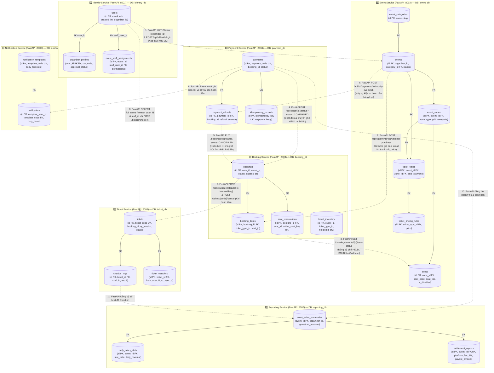

# Sơ Đồ ERD Tổng Hợp Toàn Hệ Thống (Master ERD & Tương Tác Logic Qua FastAPI Giữa 7 Microservices)

Tài liệu này thiết kế **1 Sơ đồ ERD Tổng hợp duy nhất** bao gồm toàn bộ **7 Databases (24 bảng)**, thể hiện rõ:
* **Đường nét liền (`||--o{`)**: Khóa ngoại vật lý (`Physical Foreign Key`) giữa các bảng trong **cùng 1 Database**.
* **Đường nét đứt (`||..o{`)**: Khóa tham chiếu logic (`Logical Foreign Key`) giữa **2 Microservices khác nhau**, được đồng bộ và kiểm tra toàn vẹn thông qua **các lời gọi FastAPI REST API / JWT**.

---

## 1. Sơ Đồ ERD Tổng Hợp 24 Bảng & Luồng Đồng Bộ FastAPI (Mermaid `erDiagram`)

```mermaid
erDiagram
    %% ==================== 1. IDENTITY SERVICE (identity_db - Port 8001) ====================
    USERS {
        bigint id PK
        varchar email UK
        varchar password_hash
        varchar full_name
        varchar phone
        enum role "CUSTOMER | ORGANIZER | STAFF | ADMIN"
        enum status "ACTIVE | INACTIVE | PENDING_APPROVAL"
        varchar google_id UK
        varchar auth_provider "LOCAL | GOOGLE"
        bigint created_by_organizer_id "FK nội bộ: STAFF -> ORGANIZER"
        timestamp created_at
    }

    ORGANIZER_PROFILES {
        bigint user_id PK, FK "FK -> users.id"
        varchar organization_name
        varchar tax_code
        varchar contact_phone
        varchar business_license_url
        enum approval_status "PENDING | APPROVED | REJECTED"
        bigint approved_by_admin_id
        timestamp approved_at
    }

    EVENT_STAFF_ASSIGNMENTS {
        bigint id PK
        bigint event_id "Logical FK -> event_db.events.id"
        varchar event_title
        bigint staff_user_id FK "FK -> users.id"
        bigint assigned_by_organizer_id "Logical -> users.id"
        varchar staff_role_title
        json permissions "CHECKIN, VIEW_ATTENDEES"
        boolean is_active
    }

    %% ==================== 2. EVENT SERVICE (event_db - Port 8002) ====================
    EVENT_CATEGORIES {
        int id PK
        varchar name
        varchar slug UK
    }

    EVENTS {
        bigint id PK
        bigint organizer_id "Logical FK -> identity_db.users.id"
        int category_id FK "FK -> event_categories.id"
        varchar title
        varchar slug UK
        varchar venue_name
        varchar venue_address
        datetime start_time
        datetime end_time
        enum status "DRAFT | PUBLISHED | ON_SALE | HAPPENING | COMPLETED | CANCELLED"
        text refund_policy
        text cancel_reason
        datetime cancelled_at
    }

    EVENT_ZONES {
        bigint id PK
        bigint event_id FK "FK -> events.id"
        varchar name
        enum zone_type "STANDING | SEATED"
        int total_capacity
        int grid_rows
        int grid_cols
    }

    SEATS {
        bigint id PK
        bigint zone_id FK "FK -> event_zones.id"
        int row_index
        int col_index
        varchar row_code
        int seat_number
        varchar seat_code
        boolean is_disabled
        varchar seat_tier "VIP | STANDARD | STUDENT"
    }

    TICKET_TYPES {
        bigint id PK
        bigint event_id FK "FK -> events.id"
        bigint zone_id FK "FK -> event_zones.id"
        varchar name
        int total_quantity
        int max_per_order
        boolean is_student_only
        varchar student_email_domain
        datetime sale_start_time
        datetime sale_end_time
    }

    TICKET_PRICING_RULES {
        bigint id PK
        bigint ticket_type_id FK "FK -> ticket_types.id"
        varchar rule_name "Early Bird | Regular"
        decimal price
        datetime start_time
        datetime end_time
    }

    %% ==================== 3. BOOKING SERVICE (booking_db - Port 8003) ====================
    BOOKINGS {
        int id PK
        varchar user_id "Logical FK -> identity_db.users.id"
        varchar event_id "Logical FK -> event_db.events.id"
        varchar status "PENDING_PAYMENT | CONFIRMED | CANCELLED | EXPIRED"
        decimal total_amount
        datetime created_at
        datetime expires_at "TTL +10 phút"
    }

    BOOKING_ITEMS {
        int id PK
        int booking_id FK "FK -> bookings.id"
        varchar ticket_type_id "Logical FK -> event_db.ticket_types.id"
        varchar seat_id "Logical FK -> event_db.seats.seat_code"
        int quantity
        decimal unit_price
    }

    SEAT_RESERVATIONS {
        int id PK
        varchar event_id
        varchar seat_id
        int booking_id FK "FK -> bookings.id"
        varchar status "HELD | SOLD | RELEASED"
        varchar active_seat_key UK "Computed: event_id:seat_id"
    }

    TICKET_INVENTORY {
        int id PK
        varchar event_id "Logical FK -> event_db.events.id"
        varchar ticket_type_id "Logical FK -> event_db.ticket_types.id"
        int total_quantity
        int held_quantity
        int sold_quantity
    }

    %% ==================== 4. PAYMENT SERVICE (payment_db - Port 8004) ====================
    PAYMENTS {
        bigint id PK
        varchar payment_code UK "PAY-YYYYMMDD-XXXX"
        bigint booking_id "Logical FK -> booking_db.bookings.id"
        bigint customer_id "Logical FK -> identity_db.users.id"
        decimal amount
        enum payment_method "VNPAY_SANDBOX | MOCK_GATEWAY"
        enum status "PENDING | SUCCESS | FAILED | CANCELLED | EXPIRED"
        varchar gateway_transaction_no
        varchar idempotency_key UK
        datetime paid_at
    }

    PAYMENT_REFUNDS {
        bigint id PK
        bigint payment_id FK "FK -> payments.id"
        bigint booking_id "Logical FK -> booking_db.bookings.id"
        decimal refund_amount
        varchar reason
        enum status "PENDING | PROCESSING | SUCCESS | FAILED"
        varchar gateway_refund_id
        datetime processed_at
    }

    IDEMPOTENCY_RECORDS {
        bigint id PK
        varchar idempotency_key UK
        varchar handler_name
        varchar request_hash
        json response_body
        enum status "IN_PROGRESS | COMPLETED | FAILED"
        datetime expires_at
    }

    %% ==================== 5. TICKET SERVICE (ticket_db - Port 8005) ====================
    TICKETS {
        int id PK
        varchar ticket_code UK "TK-..."
        int booking_id "Logical FK -> booking_db.bookings.id"
        int ticket_index "UK(booking_id, ticket_index)"
        varchar event_id "Logical FK -> event_db.events.id"
        varchar ticket_type_id "Logical FK -> event_db.ticket_types.id"
        varchar seat_id
        varchar owner_user_id "Logical FK -> identity_db.users.id"
        varchar owner_name
        varchar status "ISSUED | CHECKED_IN | CANCELLED"
        int qr_version
        datetime issued_at
        datetime checked_in_at
        varchar checked_in_by "Logical FK -> identity_db.users.id"
    }

    CHECKIN_LOGS {
        int id PK
        int ticket_id FK "FK -> tickets.id"
        varchar ticket_code
        varchar event_id
        varchar staff_id "Logical FK -> identity_db.users.id"
        varchar result
        datetime scanned_at
    }

    TICKET_TRANSFERS {
        int id PK
        int ticket_id FK "FK -> tickets.id"
        varchar from_user_id "Logical FK -> identity_db.users.id"
        varchar to_user_id "Logical FK -> identity_db.users.id"
        varchar to_owner_name
        datetime transferred_at
    }

    %% ==================== 6. NOTIFICATION SERVICE (notification_db - Port 8006) ====================
    NOTIFICATION_TEMPLATES {
        int id PK
        varchar template_code UK
        enum channel "EMAIL | SMS | IN_APP"
        varchar subject_template
        longtext body_template
    }

    NOTIFICATIONS {
        bigint id PK
        bigint recipient_user_id "Logical FK -> identity_db.users.id"
        varchar recipient_destination
        enum channel
        varchar template_code FK "FK -> notification_templates.template_code"
        varchar rendered_subject
        bigint event_reference_id "Logical FK -> event_db.events.id"
        enum status "PENDING | SENT | FAILED"
        tinyint retry_count
        datetime sent_at
    }

    %% ==================== 7. REPORTING SERVICE (reporting_db - Port 8007) ====================
    EVENT_SALES_SUMMARIES {
        bigint event_id PK "Logical FK -> event_db.events.id"
        bigint organizer_id "Logical FK -> identity_db.users.id"
        int total_seats_capacity
        int total_tickets_reserved
        int total_tickets_sold
        int total_tickets_checked_in
        decimal gross_revenue
        decimal total_refunded_amount
        decimal net_revenue
    }

    DAILY_SALES_STATS {
        bigint id PK
        bigint event_id FK "FK -> event_sales_summaries.event_id"
        date stat_date
        int tickets_sold_count
        decimal daily_revenue
    }

    SETTLEMENT_REPORTS {
        bigint id PK
        varchar settlement_code
        bigint event_id UK, FK "FK -> event_sales_summaries.event_id"
        bigint organizer_id "Logical FK -> identity_db.users.id"
        decimal gross_sales
        decimal platform_fee_percent "5.00%"
        decimal platform_fee_amount
        decimal payout_amount
        enum status "PENDING | APPROVED | TRANSFERRED | REJECTED"
        datetime settled_at
    }

    %% ========================================================================
    %% A. QUAN HỆ KHÓA NGOẠI VẬT LÝ NỘI BỘ (SOLID LINES: ||--o{)
    %% ========================================================================
    USERS ||--o| ORGANIZER_PROFILES : "FK user_id"
    USERS ||--o{ USERS : "FK created_by_organizer_id"
    USERS ||--o{ EVENT_STAFF_ASSIGNMENTS : "FK staff_user_id"

    EVENT_CATEGORIES ||--o{ EVENTS : "FK category_id"
    EVENTS ||--o{ EVENT_ZONES : "FK event_id"
    EVENT_ZONES ||--o{ SEATS : "FK zone_id"
    EVENTS ||--o{ TICKET_TYPES : "FK event_id"
    EVENT_ZONES ||--o{ TICKET_TYPES : "FK zone_id"
    TICKET_TYPES ||--o{ TICKET_PRICING_RULES : "FK ticket_type_id"

    BOOKINGS ||--o{ BOOKING_ITEMS : "FK booking_id"
    BOOKINGS ||--o{ SEAT_RESERVATIONS : "FK booking_id"

    PAYMENTS ||--o{ PAYMENT_REFUNDS : "FK payment_id"
    PAYMENTS ||--o| IDEMPOTENCY_RECORDS : "idempotency_key"

    TICKETS ||--o{ CHECKIN_LOGS : "FK ticket_id"
    TICKETS ||--o{ TICKET_TRANSFERS : "FK ticket_id"

    NOTIFICATION_TEMPLATES ||--o{ NOTIFICATIONS : "FK template_code"

    EVENT_SALES_SUMMARIES ||--o{ DAILY_SALES_STATS : "FK event_id"
    EVENT_SALES_SUMMARIES ||--o| SETTLEMENT_REPORTS : "FK event_id"

    %% ========================================================================
    %% B. TƯƠNG TÁC THAM CHIẾU LOGIC QUA FASTAPI GIỮA CÁC SERVICE (DASHED: ||..o{)
    %% ========================================================================
    USERS ||..o{ EVENTS : "FastAPI JWT sub + POST /api/v1/auth/login (verify cancel)"
    EVENTS ||..o{ EVENT_STAFF_ASSIGNMENTS : "FastAPI POST /api/v1/staff/assign (event_id)"
    USERS ||..o{ BOOKINGS : "FastAPI POST /bookings/hold (user_id)"
    EVENTS ||..o{ BOOKINGS : "FastAPI POST /api/v1/events/{id}/validate-purchase"
    TICKET_TYPES ||..o{ BOOKING_ITEMS : "FastAPI validate-purchase -> unit_price"
    TICKET_TYPES ||..o| TICKET_INVENTORY : "FastAPI sync total_quantity"
    SEATS ||..o{ SEAT_RESERVATIONS : "FastAPI GET /bookings/events/{id}/seat-status"
    BOOKINGS ||..o{ PAYMENTS : "FastAPI PUT /bookings/{id}/status?status=CONFIRMED"
    PAYMENT_REFUNDS ||..o| BOOKINGS : "FastAPI PUT /bookings/{id}/status?status=CANCELLED"
    EVENTS ||..o{ PAYMENT_REFUNDS : "FastAPI POST /api/v1/payments/refund-by-event/{id}"
    BOOKINGS ||..o{ TICKETS : "FastAPI POST /tickets/issue [x-internal-key]"
    BOOKINGS ||..o{ TICKETS : "FastAPI POST /tickets/{code}/cancel [x-internal-key]"
    USERS ||..o{ TICKETS : "FastAPI GET /users/{id}/tickets & POST /transfer"
    USERS ||..o{ CHECKIN_LOGS : "FastAPI POST /tickets/check-in (staff_id)"
    USERS ||..o{ NOTIFICATIONS : "FastAPI Event Hook -> POST /notifications/send"
    EVENTS ||..o| EVENT_SALES_SUMMARIES : "FastAPI Sync Sales & Check-in Metrics"
```



---

## 2. Sơ Đồ Kiến Trúc ERD Tổng & Luồng Gọi FastAPI Giữa 7 Databases (Mermaid Block Diagram)

Sơ đồ dưới đây đặt **7 Databases trong 7 khối dịch vụ FastAPI** để nhìn thấy rõ **bảng nào của Service A gọi API nào của Service B để cập nhật bảng nào**:



---

## 3. Mã DBML Tổng Hợp Đầy Đủ Liên Kết Liên Service (Dán Vào `https://dbdiagram.io/d`)

> [!TIP]
> Bản DBML dưới đây đã **nối toàn bộ các bảng giữa cả 7 Databases lại với nhau thành 1 sơ đồ tổng duy nhất** trên `dbdiagram.io` (7 cụm màu đại diện cho 7 Microservices, có đầy đủ đường nối giữa `users`, `events`, `bookings`, `payments`, `tickets`, `notifications`, `event_sales_summaries` kèm chú thích FastAPI endpoint trên từng mối quan hệ).

```dbml
// ============================================================================
// MASTER ERD (DBML): SOA EVENT PLATFORM - 7 MICROSERVICES CONNECTED VIA FASTAPI
// Copy toàn bộ dán vào https://dbdiagram.io/d để xuất 1 hình ERD Tổng duy nhất
// ============================================================================

// ==================== 1. IDENTITY_DB (FastAPI :8001) ====================
TableGroup "1_identity_db (FastAPI :8001)" {
  users
  organizer_profiles
  event_staff_assignments
}

Table users {
  id bigint [pk, increment]
  email varchar(191) [not null, unique]
  password_hash varchar(255)
  full_name varchar(100) [not null]
  phone varchar(20)
  role varchar(20) [not null, default: 'CUSTOMER', note: 'CUSTOMER | ORGANIZER | STAFF | ADMIN']
  status varchar(30) [not null, default: 'ACTIVE', note: 'ACTIVE | INACTIVE | PENDING_APPROVAL']
  google_id varchar(100) [unique]
  auth_provider varchar(20) [not null, default: 'LOCAL']
  avatar_url varchar(255)
  created_by_organizer_id bigint [note: 'FK nội bộ: Organizer quản lý Staff này']
  created_at timestamp
  updated_at timestamp
}

Table organizer_profiles {
  user_id bigint [pk]
  organization_name varchar(191) [not null]
  tax_code varchar(50)
  contact_phone varchar(20) [not null]
  business_license_url varchar(255)
  approval_status varchar(20) [not null, default: 'PENDING']
  approved_by_admin_id bigint
  approved_at timestamp
  created_at timestamp
  updated_at timestamp
}

Table event_staff_assignments {
  id bigint [pk, increment]
  event_id bigint [not null, note: 'Logical FK -> events.id qua FastAPI POST /api/v1/staff/assign']
  event_title varchar(255)
  staff_user_id bigint [not null]
  assigned_by_organizer_id bigint [not null]
  staff_role_title varchar(100) [not null]
  permissions json [not null]
  is_active boolean [not null, default: true]
  created_at timestamp
}

// ==================== 2. EVENT_DB (FastAPI :8002) ====================
TableGroup "2_event_db (FastAPI :8002)" {
  event_categories
  events
  event_zones
  seats
  ticket_types
  ticket_pricing_rules
}

Table event_categories {
  id int [pk, increment]
  name varchar(100) [not null]
  slug varchar(120) [not null, unique]
  created_at timestamp
  updated_at timestamp
}

Table events {
  id bigint [pk, increment]
  organizer_id bigint [not null, note: 'Logical FK -> users.id qua FastAPI JWT & POST /api/v1/auth/login']
  category_id int [not null]
  title varchar(255) [not null]
  slug varchar(255) [not null, unique]
  short_description varchar(500)
  description text
  banner_url varchar(255)
  venue_name varchar(191) [not null]
  venue_address varchar(255) [not null]
  start_time datetime [not null]
  end_time datetime [not null]
  status varchar(20) [not null, default: 'DRAFT']
  refund_policy text
  cancel_reason text
  cancelled_at datetime
  created_at timestamp
  updated_at timestamp
}

Table event_zones {
  id bigint [pk, increment]
  event_id bigint [not null]
  name varchar(100) [not null]
  zone_type varchar(20) [not null, note: 'STANDING | SEATED']
  total_capacity int [not null, default: 0]
  grid_rows int
  grid_cols int
  created_at timestamp
  updated_at timestamp
}

Table seats {
  id bigint [pk, increment]
  zone_id bigint [not null]
  row_index int [not null]
  col_index int [not null]
  row_code varchar(10) [not null]
  seat_number int [not null]
  seat_code varchar(20) [not null]
  is_disabled boolean [not null, default: false]
  seat_tier varchar(50) [not null, default: 'STANDARD']
  created_at timestamp
  updated_at timestamp
}

Table ticket_types {
  id bigint [pk, increment]
  event_id bigint [not null]
  zone_id bigint [not null]
  name varchar(100) [not null]
  description varchar(255)
  total_quantity int [not null]
  max_per_order int [not null, default: 4]
  is_student_only boolean [not null, default: false]
  student_email_domain varchar(100)
  sale_start_time datetime
  sale_end_time datetime
  created_at timestamp
  updated_at timestamp
}

Table ticket_pricing_rules {
  id bigint [pk, increment]
  ticket_type_id bigint [not null]
  rule_name varchar(100) [not null]
  price decimal(12,2) [not null]
  start_time datetime [not null]
  end_time datetime [not null]
  created_at timestamp
  updated_at timestamp
}

// ==================== 3. BOOKING_DB (FastAPI :8003) ====================
TableGroup "3_booking_db (FastAPI :8003)" {
  bookings
  booking_items
  seat_reservations
  ticket_inventory
}

Table bookings {
  id int [pk, increment]
  user_id bigint [not null, note: 'Logical FK -> users.id qua FastAPI POST /bookings/hold']
  event_id bigint [not null, note: 'Logical FK -> events.id qua FastAPI POST /validate-purchase']
  status varchar(20) [not null, default: 'PENDING_PAYMENT']
  total_amount decimal(12,2) [not null]
  created_at datetime [not null]
  expires_at datetime [not null, note: 'TTL +10 phút']
}

Table booking_items {
  id int [pk, increment]
  booking_id int [not null]
  ticket_type_id bigint [not null, note: 'Logical FK -> ticket_types.id qua FastAPI /validate-purchase']
  seat_id varchar(50)
  quantity int [not null, default: 1]
  unit_price decimal(12,2) [not null]
}

Table seat_reservations {
  id int [pk, increment]
  event_id bigint [not null]
  seat_id varchar(50) [not null]
  booking_id int [not null]
  status varchar(10) [not null, default: 'HELD', note: 'HELD | SOLD | RELEASED']
  active_seat_key varchar(110) [unique, note: 'Computed: event_id:seat_id']
}

Table ticket_inventory {
  id int [pk, increment]
  event_id bigint [not null]
  ticket_type_id bigint [not null]
  total_quantity int [not null]
  held_quantity int [not null, default: 0]
  sold_quantity int [not null, default: 0]
}

// ==================== 4. PAYMENT_DB (FastAPI :8004) ====================
TableGroup "4_payment_db (FastAPI :8004)" {
  payments
  payment_refunds
  idempotency_records
}

Table payments {
  id bigint [pk, increment]
  payment_code varchar(64) [not null, unique]
  booking_id int [not null, note: 'Logical FK -> bookings.id qua FastAPI PUT /bookings/{id}/status']
  customer_id bigint [not null, note: 'Logical FK -> users.id qua FastAPI JWT']
  amount decimal(12,2) [not null]
  currency varchar(10) [not null, default: 'VND']
  payment_method varchar(30) [not null, default: 'VNPAY_SANDBOX']
  status varchar(20) [not null, default: 'PENDING']
  gateway_transaction_no varchar(100)
  gateway_response_raw json
  idempotency_key varchar(128) [not null, unique]
  paid_at datetime
  created_at timestamp
  updated_at timestamp
}

Table payment_refunds {
  id bigint [pk, increment]
  payment_id bigint [not null]
  booking_id int [not null]
  refund_amount decimal(12,2) [not null]
  reason varchar(255) [not null]
  status varchar(20) [not null, default: 'PENDING']
  gateway_refund_id varchar(100)
  error_details text
  processed_at datetime
  created_at timestamp
  updated_at timestamp
}

Table idempotency_records {
  id bigint [pk, increment]
  idempotency_key varchar(128) [not null, unique]
  handler_name varchar(100) [not null]
  request_hash varchar(64) [not null]
  response_body json
  status varchar(20) [not null, default: 'IN_PROGRESS']
  expires_at datetime [not null]
  created_at timestamp
}

// ==================== 5. TICKET_DB (FastAPI :8005) ====================
TableGroup "5_ticket_db (FastAPI :8005)" {
  tickets
  checkin_logs
  ticket_transfers
}

Table tickets {
  id int [pk, increment]
  ticket_code varchar(40) [not null, unique]
  booking_id int [not null, note: 'Logical FK -> bookings.id qua FastAPI POST /tickets/issue [x-internal-key]']
  ticket_index int [not null, default: 1]
  event_id bigint [not null, note: 'Logical FK -> events.id']
  ticket_type_id bigint [not null, note: 'Logical FK -> ticket_types.id']
  seat_id varchar(50)
  owner_user_id bigint [not null, note: 'Logical FK -> users.id']
  owner_name varchar(100) [not null]
  status varchar(20) [not null, default: 'ISSUED']
  qr_version int [not null, default: 1]
  issued_at datetime [not null]
  checked_in_at datetime
  checked_in_by bigint
}

Table checkin_logs {
  id int [pk, increment]
  ticket_id int
  ticket_code varchar(60)
  event_id bigint
  staff_id bigint [not null, note: 'Logical FK -> users.id qua FastAPI POST /tickets/check-in']
  result varchar(30) [not null]
  scanned_at datetime [not null]
}

Table ticket_transfers {
  id int [pk, increment]
  ticket_id int [not null]
  from_user_id bigint [not null]
  to_user_id bigint [not null]
  to_owner_name varchar(100) [not null]
  transferred_at datetime [not null]
}

// ==================== 6. NOTIFICATION_DB (FastAPI :8006) ====================
TableGroup "6_notification_db (FastAPI :8006)" {
  notification_templates
  notifications
}

Table notification_templates {
  id int [pk, increment]
  template_code varchar(50) [not null, unique]
  channel varchar(20) [not null, default: 'EMAIL']
  subject_template varchar(255) [not null]
  body_template longtext [not null]
  created_at timestamp
  updated_at timestamp
}

Table notifications {
  id bigint [pk, increment]
  recipient_user_id bigint [not null, note: 'Logical FK -> users.id']
  recipient_destination varchar(191) [not null]
  channel varchar(20) [not null, default: 'EMAIL']
  template_code varchar(50) [not null]
  rendered_subject varchar(255) [not null]
  rendered_content longtext [not null]
  event_reference_id bigint [note: 'Logical FK -> events.id']
  status varchar(20) [not null, default: 'PENDING']
  retry_count tinyint [not null, default: 0]
  error_log text
  sent_at datetime
  created_at timestamp
}

// ==================== 7. REPORTING_DB (FastAPI :8007) ====================
TableGroup "7_reporting_db (FastAPI :8007)" {
  event_sales_summaries
  daily_sales_stats
  settlement_reports
}

Table event_sales_summaries {
  event_id bigint [pk, note: 'Logical FK -> events.id']
  organizer_id bigint [not null, note: 'Logical FK -> users.id']
  total_seats_capacity int [not null, default: 0]
  total_tickets_reserved int [not null, default: 0]
  total_tickets_sold int [not null, default: 0]
  total_tickets_checked_in int [not null, default: 0]
  gross_revenue decimal(15,2) [not null, default: 0.00]
  total_refunded_amount decimal(15,2) [not null, default: 0.00]
  net_revenue decimal(15,2) [not null, default: 0.00]
  last_event_time datetime
  last_updated_at timestamp
}

Table daily_sales_stats {
  id bigint [pk, increment]
  event_id bigint [not null]
  stat_date date [not null]
  tickets_sold_count int [not null, default: 0]
  daily_revenue decimal(14,2) [not null, default: 0.00]
}

Table settlement_reports {
  id bigint [pk, increment]
  settlement_code varchar(50) [not null]
  event_id bigint [not null, unique]
  organizer_id bigint [not null]
  gross_sales decimal(15,2) [not null]
  platform_fee_percent decimal(5,2) [not null, default: 5.00]
  platform_fee_amount decimal(15,2) [not null]
  payout_amount decimal(15,2) [not null]
  status varchar(20) [not null, default: 'PENDING']
  settled_at datetime
  created_at timestamp
}

// ============================================================================
// A. KHÓA NGOẠI VẬT LÝ NỘI BỘ (INTRA-SERVICE PHYSICAL FKs)
// ============================================================================
Ref: organizer_profiles.user_id - users.id
Ref: users.created_by_organizer_id > users.id
Ref: event_staff_assignments.staff_user_id > users.id

Ref: events.category_id > event_categories.id
Ref: event_zones.event_id > events.id
Ref: seats.zone_id > event_zones.id
Ref: ticket_types.event_id > events.id
Ref: ticket_types.zone_id > event_zones.id
Ref: ticket_pricing_rules.ticket_type_id > ticket_types.id

Ref: booking_items.booking_id > bookings.id
Ref: seat_reservations.booking_id > bookings.id

Ref: payment_refunds.payment_id > payments.id
Ref: payments.idempotency_key - idempotency_records.idempotency_key

Ref: checkin_logs.ticket_id > tickets.id
Ref: ticket_transfers.ticket_id > tickets.id

Ref: notifications.template_code > notification_templates.template_code

Ref: daily_sales_stats.event_id > event_sales_summaries.event_id
Ref: settlement_reports.event_id - event_sales_summaries.event_id

// ============================================================================
// B. THAM CHIẾU LOGIC LIÊN SERVICE QUA FASTAPI (INTER-SERVICE LOGICAL REFs)
// ============================================================================
Ref: events.organizer_id > users.id
Ref: event_staff_assignments.event_id > events.id
Ref: bookings.user_id > users.id
Ref: bookings.event_id > events.id
Ref: booking_items.ticket_type_id > ticket_types.id
Ref: ticket_inventory.ticket_type_id - ticket_types.id
Ref: payments.booking_id > bookings.id
Ref: payments.customer_id > users.id
Ref: tickets.booking_id > bookings.id
Ref: tickets.event_id > events.id
Ref: tickets.owner_user_id > users.id
Ref: checkin_logs.staff_id > users.id
Ref: notifications.recipient_user_id > users.id
Ref: notifications.event_reference_id > events.id
Ref: event_sales_summaries.event_id - events.id
Ref: event_sales_summaries.organizer_id > users.id
```

---

## 4. Mã PlantUML Master ERD (Phân Biệt Nét Liền Cho Physical FK & Nét Đứt Có Nhãn FastAPI Cho Logical FK)

> [!TIP]
> Nếu bạn dùng **PlantUML** hoặc **Draw.io** (`Arrange -> Insert -> Advanced -> PlantUML`), đoạn code dưới đây sẽ vẽ **1 bức ảnh ERD Tổng duy nhất** gom 7 khung Database, trong đó **khóa ngoại nội bộ là đường nét liền**, còn **tương tác qua FastAPI giữa các service là đường nét đứt kèm tên endpoint FastAPI**.

```plantuml
@startuml SOA_Master_ERD_With_FastAPI_Interactions
hide circle
skinparam linetype ortho
skinparam shadowing false
skinparam packageStyle rectangle

package "1. identity_db (FastAPI :8001)" #EFF6FF {
  entity "users" as users {
    * **id** : BIGINT <<PK>>
    --
    * email : VARCHAR(191) <<UK>>
    password_hash : VARCHAR(255)
    * full_name : VARCHAR(100)
    phone : VARCHAR(20)
    * role : ENUM(CUSTOMER,ORGANIZER,STAFF,ADMIN)
    * status : ENUM(ACTIVE,INACTIVE,PENDING_APPROVAL)
    google_id : VARCHAR(100) <<UK>>
    created_by_organizer_id : BIGINT <<FK>>
  }

  entity "organizer_profiles" as org_profiles {
    * **user_id** : BIGINT <<PK, FK>>
    --
    * organization_name : VARCHAR(191)
    tax_code : VARCHAR(50)
    * contact_phone : VARCHAR(20)
    business_license_url : VARCHAR(255)
    * approval_status : ENUM(PENDING,APPROVED,REJECTED)
  }

  entity "event_staff_assignments" as staff_assign {
    * **id** : BIGINT <<PK>>
    --
    * event_id : BIGINT <<Logical FK>>
    * staff_user_id : BIGINT <<FK>>
    * assigned_by_organizer_id : BIGINT
    * staff_role_title : VARCHAR(100)
    * permissions : JSON
  }
}

package "2. event_db (FastAPI :8002)" #F0FDF4 {
  entity "event_categories" as categories {
    * **id** : INT <<PK>>
    --
    * name : VARCHAR(100)
    * slug : VARCHAR(120) <<UK>>
  }

  entity "events" as events {
    * **id** : BIGINT <<PK>>
    --
    * organizer_id : BIGINT <<Logical FK>>
    * category_id : INT <<FK>>
    * title : VARCHAR(255)
    * venue_name : VARCHAR(191)
    * start_time : DATETIME
    * end_time : DATETIME
    * status : ENUM(DRAFT,PUBLISHED,ON_SALE,COMPLETED,CANCELLED)
  }

  entity "event_zones" as zones {
    * **id** : BIGINT <<PK>>
    --
    * event_id : BIGINT <<FK>>
    * name : VARCHAR(100)
    * zone_type : ENUM(STANDING,SEATED)
    * total_capacity : INT
    grid_rows : INT
    grid_cols : INT
  }

  entity "seats" as seats {
    * **id** : BIGINT <<PK>>
    --
    * zone_id : BIGINT <<FK>>
    * seat_code : VARCHAR(20)
    * seat_tier : VARCHAR(50)
    * is_disabled : BOOLEAN
  }

  entity "ticket_types" as ticket_types {
    * **id** : BIGINT <<PK>>
    --
    * event_id : BIGINT <<FK>>
    * zone_id : BIGINT <<FK>>
    * name : VARCHAR(100)
    * total_quantity : INT
    * max_per_order : INT
    * is_student_only : BOOLEAN
    student_email_domain : VARCHAR(100)
    sale_start_time : DATETIME
    sale_end_time : DATETIME
  }

  entity "ticket_pricing_rules" as pricing_rules {
    * **id** : BIGINT <<PK>>
    --
    * ticket_type_id : BIGINT <<FK>>
    * rule_name : VARCHAR(100)
    * price : DECIMAL(12,2)
    * start_time : DATETIME
    * end_time : DATETIME
  }
}

package "3. booking_db (FastAPI :8003)" #FEFCE8 {
  entity "bookings" as bookings {
    * **id** : INT <<PK>>
    --
    * user_id : VARCHAR(50) <<Logical FK>>
    * event_id : VARCHAR(50) <<Logical FK>>
    * status : VARCHAR(20)
    * total_amount : DECIMAL(12,2)
    * expires_at : DATETIME (TTL 10m)
  }

  entity "booking_items" as booking_items {
    * **id** : INT <<PK>>
    --
    * booking_id : INT <<FK>>
    * ticket_type_id : VARCHAR(50) <<Logical FK>>
    seat_id : VARCHAR(50)
    * quantity : INT
    * unit_price : DECIMAL(12,2)
  }

  entity "seat_reservations" as seat_res {
    * **id** : INT <<PK>>
    --
    * booking_id : INT <<FK>>
    * event_id : VARCHAR(50)
    * seat_id : VARCHAR(50)
    * status : VARCHAR(10) (HELD,SOLD,RELEASED)
    active_seat_key : VARCHAR(110) <<UK Computed>>
  }

  entity "ticket_inventory" as inventory {
    * **id** : INT <<PK>>
    --
    * event_id : VARCHAR(50)
    * ticket_type_id : VARCHAR(50) <<Logical FK>>
    * total_quantity : INT
    * held_quantity : INT
    * sold_quantity : INT
  }
}

package "4. payment_db (FastAPI :8004)" #FFF7ED {
  entity "payments" as payments {
    * **id** : BIGINT <<PK>>
    --
    * payment_code : VARCHAR(64) <<UK>>
    * booking_id : BIGINT <<Logical FK>>
    * customer_id : BIGINT <<Logical FK>>
    * amount : DECIMAL(12,2)
    * status : ENUM(PENDING,SUCCESS,FAILED,CANCELLED)
    * idempotency_key : VARCHAR(128) <<UK>>
  }

  entity "payment_refunds" as refunds {
    * **id** : BIGINT <<PK>>
    --
    * payment_id : BIGINT <<FK>>
    * booking_id : BIGINT <<Logical FK>>
    * refund_amount : DECIMAL(12,2)
    * reason : VARCHAR(255)
    * status : ENUM(PENDING,SUCCESS,FAILED)
  }

  entity "idempotency_records" as idempotency {
    * **id** : BIGINT <<PK>>
    --
    * idempotency_key : VARCHAR(128) <<UK>>
    * handler_name : VARCHAR(100)
    * request_hash : VARCHAR(64)
    * status : ENUM(IN_PROGRESS,COMPLETED,FAILED)
  }
}

package "5. ticket_db (FastAPI :8005)" #FAF5FF {
  entity "tickets" as tickets {
    * **id** : INT <<PK>>
    --
    * ticket_code : VARCHAR(40) <<UK>>
    * booking_id : INT <<Logical FK>>
    * ticket_index : INT
    * event_id : VARCHAR(50) <<Logical FK>>
    * ticket_type_id : VARCHAR(50)
    seat_id : VARCHAR(50)
    * owner_user_id : VARCHAR(50) <<Logical FK>>
    * owner_name : VARCHAR(100)
    * status : VARCHAR(20) (ISSUED,CHECKED_IN,CANCELLED)
    * qr_version : INT
  }

  entity "checkin_logs" as checkin_logs {
    * **id** : INT <<PK>>
    --
    ticket_id : INT <<FK>>
    ticket_code : VARCHAR(60)
    * staff_id : VARCHAR(50) <<Logical FK>>
    * result : VARCHAR(30)
    * scanned_at : DATETIME
  }

  entity "ticket_transfers" as transfers {
    * **id** : INT <<PK>>
    --
    * ticket_id : INT <<FK>>
    * from_user_id : VARCHAR(50)
    * to_user_id : VARCHAR(50)
    * to_owner_name : VARCHAR(100)
  }
}

package "6. notification_db (FastAPI :8006)" #FDF2F8 {
  entity "notification_templates" as noti_tpl {
    * **id** : INT <<PK>>
    --
    * template_code : VARCHAR(50) <<UK>>
    * channel : ENUM(EMAIL,SMS,IN_APP)
    * subject_template : VARCHAR(255)
  }

  entity "notifications" as notifications {
    * **id** : BIGINT <<PK>>
    --
    * recipient_user_id : BIGINT <<Logical FK>>
    * template_code : VARCHAR(50) <<FK>>
    event_reference_id : BIGINT <<Logical FK>>
    * status : ENUM(PENDING,SENT,FAILED)
    * retry_count : TINYINT
  }
}

package "7. reporting_db (FastAPI :8007)" #F0FDFA {
  entity "event_sales_summaries" as sales_sum {
    * **event_id** : BIGINT <<PK, Logical FK>>
    --
    * organizer_id : BIGINT <<Logical FK>>
    * total_tickets_sold : INT
    * total_tickets_checked_in : INT
    * gross_revenue : DECIMAL(15,2)
    * total_refunded_amount : DECIMAL(15,2)
    * net_revenue : DECIMAL(15,2)
  }

  entity "daily_sales_stats" as daily_stats {
    * **id** : BIGINT <<PK>>
    --
    * event_id : BIGINT <<FK>>
    * stat_date : DATE
    * tickets_sold_count : INT
    * daily_revenue : DECIMAL(14,2)
  }

  entity "settlement_reports" as settlements {
    * **id** : BIGINT <<PK>>
    --
    * settlement_code : VARCHAR(50)
    * event_id : BIGINT <<UK, FK>>
    * gross_sales : DECIMAL(15,2)
    * platform_fee_percent : DECIMAL(5,2) (5%)
    * payout_amount : DECIMAL(15,2)
    * status : ENUM(PENDING,APPROVED,TRANSFERRED)
  }
}

' === 1. KHÓA NGOẠI VẬT LÝ NỘI BỘ (SOLID LINES) ===
users ||--o| org_profiles
users ||--o{ users : "created_by_organizer_id"
users ||--o{ staff_assign

categories ||--o{ events
events ||--o{ zones
zones ||--o{ seats
events ||--o{ ticket_types
zones ||--o{ ticket_types
ticket_types ||--o{ pricing_rules

bookings ||--o{ booking_items
bookings ||--o{ seat_res

payments ||--o{ refunds
payments ||--o| idempotency

tickets ||--o{ checkin_logs
tickets ||--o{ transfers

noti_tpl ||--o{ notifications

sales_sum ||--o{ daily_stats
sales_sum ||--o| settlements

' === 2. TƯƠNG TÁC LOGIC QUA FASTAPI GIỮA CÁC SERVICE (DASHED LINES) ===
users ||..o{ events : "FastAPI JWT + POST /api/v1/auth/login"
events ||..o{ staff_assign : "FastAPI POST /api/v1/staff/assign"
users ||..o{ bookings : "FastAPI POST /bookings/hold"
events ||..o{ bookings : "FastAPI POST /api/v1/events/{id}/validate-purchase"
ticket_types ||..o{ booking_items : "FastAPI /validate-purchase (unit_price)"
ticket_types ||..o| inventory : "FastAPI sync inventory"
seats ||..o{ seat_res : "FastAPI GET /bookings/events/{id}/seat-status"
bookings ||..o{ payments : "FastAPI PUT /bookings/{id}/status?status=CONFIRMED"
refunds ||..o| bookings : "FastAPI PUT /bookings/{id}/status?status=CANCELLED"
events ||..o{ refunds : "FastAPI POST /api/v1/payments/refund-by-event/{id}"
bookings ||..o{ tickets : "FastAPI POST /tickets/issue & /cancel [x-internal-key]"
users ||..o{ tickets : "FastAPI GET /users/{id}/tickets & POST /transfer"
users ||..o{ checkin_logs : "FastAPI POST /tickets/check-in"
users ||..o{ notifications : "FastAPI Event Notification Hook"
events ||..o| sales_sum : "FastAPI Reporting Metrics Sync"
@enduml
```


