# Thiết Kế Use Case Diagram — Nền Tảng Quản Lý Sự Kiện & Bán Vé (Đầy Đủ 7 Microservices SOA)

Tài liệu thiết kế Use Case dưới đây bao phủ trọn vẹn **7 Microservices** của đồ án và tuân thủ phân loại tác nhân chuẩn của **Craig Larman (*Applying UML and Patterns*)**: **Primary Actors**, **Supporting Actors** (Hệ thống ngoài + 7 Microservices nội bộ) và **Offstage Actors**.

---

## 1. Phân Loại Đầy Đủ Các Tác Nhân (Actors Classification)

### A. Primary Actors (Tác nhân chính — Chủ động kích hoạt Use Case)
| Ký hiệu | Tác nhân (Actor) | Vai trò & Mục tiêu chính |
| :--- | :--- | :--- |
| **PA1** | **Khách hàng (Customer)** | Đăng ký tài khoản, đăng nhập, xem danh sách sự kiện công khai & sơ đồ ghế, chọn ghế/vé đứng, giữ chỗ 10 phút, thanh toán VNPay, hủy giữ chỗ, yêu cầu hoàn tiền, xem vé QR, sang nhượng vé, nộp hồ sơ nâng cấp lên Ban tổ chức. |
| **PA2** | **Ban tổ chức (Organizer)** | Tạo/quản lý vòng đời sự kiện, vẽ sơ đồ ghế (`Grid Map`), cấu hình hạng vé & thời gian mở bán & giá Early Bird, quản lý nhân viên độc lập (`#1, #2...`), phân công soát vé, hủy sự kiện xác thực 3 lớp, **xem Dashboard doanh thu/check-in & tra cứu người tham dự**, theo dõi quyết toán sau sự kiện. |
| **PA3** | **Nhân viên sự kiện (Event Staff)** | Quét mã QR ký số để check-in khách tại cổng, tra cứu danh sách người tham dự theo phân quyền (`CHECKIN`, `VIEW_ATTENDEES`). |
| **PA4** | **Quản trị viên (System Admin)** | Thẩm định hồ sơ pháp lý Ban tổ chức (`Phê duyệt` / `Từ chối` / `Thu hồi quyền`), quản lý danh sách toàn bộ đối tác, **xem Dashboard tổng quan toàn sàn & phê duyệt chi trả đối soát tài chính (`Settlement Report`)**. |
| **PA5** | **Bộ định thời (System Scheduler / Timer)** | Tự động thu hồi đơn giữ chỗ quá hạn 10 phút (`TTL Auto-Release`), **gửi email nhắc lịch sự kiện trước 24 giờ (kèm `.ics`), thử lại hàng đợi email lỗi (`Retry`), và tổng hợp báo cáo quyết toán khi sự kiện kết thúc**. |

---

### B. Supporting Actors (Tác nhân phụ trợ — Cung cấp dịch vụ phía sau cho Use Case)

> [!NOTE]
> Trong kiến trúc hướng dịch vụ (**SOA / Microservices**), ngoài các hệ thống bên thứ ba (`VNPay`, `Google`, `SMTP`), **cả 7 Microservices chuyên biệt** đóng vai trò là **Supporting Actors** phối hợp với nhau để hoàn tất các Use Case nghiệp vụ liên dịch vụ.

#### Nhóm B1 — Hệ thống tích hợp bên ngoài (External Supporting Actors)
1. **VNPay Payment Gateway**: Cổng thanh toán xử lý giao dịch ngân hàng, trả kết quả qua Return URL & IPN Webhook kèm chữ ký số `HMAC-SHA512`.
2. **Google OAuth 2.0 Server**: Xác thực danh tính người dùng khi đăng nhập một chạm bằng Google (`id_token`).
3. **SMTP / Email Server**: Hạ tầng máy chủ chuyển phát email thực tế ra Internet tới hộp thư người dùng.

#### Nhóm B2 — 7 Microservices nội bộ của Nền tảng (Internal Service Supporting Actors)
4. **1. Identity Service (`:8001`)**: Quản lý tài khoản, cấp & xác thực JWT Token (phiên tối đa 2 tiếng), kiểm soát phân quyền RBAC, duyệt Organizer, phân công nhân sự độc lập.
5. **2. Event Service (`:8002`)**: Quản lý vòng đời sự kiện, sơ đồ lưới ghế (`Grid Map`), kiểm tra điều kiện mua vé (khung giờ mở bán, email sinh viên `@tdtu.edu.vn`, giới hạn vé/đơn, giá động Early Bird).
6. **3. Booking Service (`:8003`)**: Khóa ghế nguyên tử chống trùng lặp (`Concurrency Lock`), quản lý giữ chỗ 10 phút (`TTL`) và tồn kho vé đứng, điều phối trạng thái đơn hàng.
7. **4. Payment Service (`:8004`)**: Tạo phiên VNPay, kiểm tra chữ ký bảo mật, chống trừ tiền trùng lặp (`Idempotency Key`) và xử lý hoàn tiền (`Refund`).
8. **5. Ticket Service (`:8005`)**: Phát hành vé điện tử (`x-internal-key`), ký & xác thực chữ ký số QR chống giả (`HMAC-SHA256`), nâng `qr_version` khi sang nhượng, chặn check-in trùng lặp.
9. **6. Notification Service (`:8006`)**: Quản lý mẫu thông báo HTML (`notification_templates`), tự động kết xuất & gửi email (nhắc 10p thanh toán, gửi vé QR, báo đổi giờ/hủy sự kiện, nhắc lịch trước 24h kèm `.ics`) với cơ chế hàng đợi tự thử lại (`Retry`).
10. **7. Reporting Service (`:8007`)**: Đọc & tổng hợp số liệu thống kê realtime cho Organizer (`event_sales_summaries`, `daily_sales_stats`), thống kê toàn sàn cho Admin và tự động tính quyết toán đối soát tài chính (`Tổng thu - 5% phí sàn = Tiền chi trả BTC`).

---

### C. Offstage Actors (Tác nhân hậu trường — Có quyền lợi/ràng buộc nhưng không trực tiếp thao tác)
| Ký hiệu | Tác nhân hậu trường | Mối quan tâm / Quyền lợi cần hệ thống bảo vệ (Interests) |
| :--- | :--- | :--- |
| **OA1** | **Cơ quan Thuế & Pháp lý Nhà nước** | Đảm bảo Ban tổ chức hoạt động có Mã số thuế (`tax_code`) và Giấy phép kinh doanh hợp lệ; báo cáo quyết toán doanh thu & hoàn tiền minh bạch. |
| **OA2** | **Trường Đại học / Đơn vị liên kết (VD: TDTU)** | Đảm bảo ưu đãi giá **Vé Sinh Viên** chỉ bán đúng cho sinh viên có email học vụ hợp lệ (`@tdtu.edu.vn`) và giới hạn tối đa 4 vé/đơn. |
| **OA3** | **Ngân hàng phát hành thẻ (Issuing Bank)** | Đảm bảo giao dịch thanh toán/hoàn tiền chính xác, không bị gọi đúp nhờ cơ chế `Idempotency`. |
| **OA4** | **Bộ phận Kế toán / Tài chính Sàn** | Quan tâm đến độ chính xác của bảng quyết toán (`settlement_reports`), khoản khấu trừ **phí nền tảng 5%**, nhật ký hoàn tiền và nhật ký check-in giải quyết khiếu nại. |

---

## 2. Sơ Đồ Use Case Tổng Quan Đầy Đủ 7 Services (Mermaid Visual Diagram)

```mermaid
flowchart LR
    %% ==================== PRIMARY ACTORS (LEFT) ====================
    subgraph PRIMARY["👤 PRIMARY ACTORS (Tác nhân chính)"]
        direction TB
        Customer["🛒 Customer\n(Khách hàng)"]
        Organizer["🏢 Organizer\n(Ban tổ chức)"]
        Staff["🎫 Event Staff\n(Nhân viên sự kiện)"]
        Admin["🛡️ System Admin\n(Quản trị viên)"]
        Timer["⏱️ System Timer\n(Bộ định thời)"]
    end

    %% ==================== SYSTEM BOUNDARY (CENTER) ====================
    subgraph SYSTEM["🏛️ NỀN TẢNG QUẢN LÝ SỰ KIỆN & BÁN VÉ SOA (7 MICROSERVICES)"]
        direction TB

        subgraph MOD_AUTH["1. Định danh & Đối tác (Identity)"]
            UC01(["UC01: Đăng ký tài khoản"])
            UC02(["UC02: Đăng nhập JWT (Tối đa 2h)"])
            UC03(["UC03: Đăng nhập Google OAuth"])
            UC04(["UC04: Đăng ký làm Ban tổ chức"])
            UC05(["UC05: Duyệt / Từ chối / Thu hồi quyền BTC"])
            UC06(["UC06: Xem & Lọc danh sách tất cả BTC"])
        end

        subgraph MOD_EVENT["2. Sự kiện & Nhân sự (Event & Staff)"]
            UC07(["UC07: Xem & Tìm kiếm sự kiện công khai"])
            UC08(["UC08: Tạo sự kiện & Công bố mở bán"])
            UC09(["UC09: Thiết kế Sơ đồ ghế (Grid Map) & Khu đứng"])
            UC10(["UC10: Cấu hình Loại vé, Giờ bán & Giá Early Bird"])
            UC11(["UC11: Hủy sự kiện (Xác thực bảo mật 3 lớp)"])
            UC12(["UC12: Quản lý DS Nhân viên độc lập (#1..#n)"])
            UC13(["UC13: Phân công Nhân sự theo Sự kiện"])
        end

        subgraph MOD_BOOK_PAY["3. Đặt giữ chỗ & Thanh toán (Booking & Payment)"]
            UC14(["UC14: Chọn ghế & Giữ chỗ 10 phút"])
            UC15(["UC15: Kiểm tra giờ bán & Email Sinh viên"])
            UC16(["UC16: Thanh toán VNPay & Redirect về Web"])
            UC17(["UC17: Hủy giữ chỗ / Tự động nhả ghế quá 10p"])
            UC18(["UC18: Hoàn tiền giao dịch (Refund)"])
        end

        subgraph MOD_TICKET["4. Vé điện tử QR & Check-in (Ticket)"]
            UC19(["UC19: Phát hành Vé QR ký số HMAC-SHA256"])
            UC20(["UC20: Xem danh sách Vé QR của tôi"])
            UC21(["UC21: Sang nhượng vé (Vô hiệu hóa QR cũ)"])
            UC22(["UC22: Quét mã QR Check-in tại cổng"])
            UC23(["UC23: Tra cứu danh sách Khách tham dự"])
        end

        subgraph MOD_NOTI_REP["5. Thông báo & Báo cáo Đối soát (Notification & Reporting)"]
            UC24(["UC24: Gửi Email tự động (Giữ chỗ, Vé QR, Hủy SK) & Retry"])
            UC25(["UC25: Nhắc lịch sự kiện trước 24h (kèm file .ics)"])
            UC26(["UC26: Xem Dashboard Doanh thu, Tốc độ bán & Check-in"])
            UC27(["UC27: Thống kê toàn sàn & Duyệt đối soát (Phí sàn 5%)"])
        end
    end

    %% ==================== SUPPORTING ACTORS (RIGHT) ====================
    subgraph SUPPORTING["⚙️ SUPPORTING ACTORS (External & 7 Microservices)"]
        direction TB
        GoogleSvc["🌐 Google OAuth 2.0"]
        VNPaySvc["💳 VNPay Gateway"]
        MailSvc["📧 SMTP Server"]
        S1["1️⃣ Identity Service :8001"]
        S2["2️⃣ Event Service :8002"]
        S3["3️⃣ Booking Service :8003"]
        S4["4️⃣ Payment Service :8004"]
        S5["5️⃣ Ticket Service :8005"]
        S6["6️⃣ Notification Service :8006"]
        S7["7️⃣ Reporting Service :8007"]
    end

    %% Primary Actor -> Use Cases
    Customer --> UC01
    Customer --> UC02
    Customer --> UC04
    Customer --> UC07
    Customer --> UC14
    Customer --> UC16
    Customer --> UC17
    Customer --> UC18
    Customer --> UC20
    Customer --> UC21

    Organizer --> UC08
    Organizer --> UC09
    Organizer --> UC10
    Organizer --> UC11
    Organizer --> UC12
    Organizer --> UC13
    Organizer --> UC26

    Staff --> UC22
    Staff --> UC23

    Admin --> UC05
    Admin --> UC06
    Admin --> UC27

    Timer --> UC17
    Timer --> UC24
    Timer --> UC25
    Timer --> UC27

    %% Include / Extend
    UC03 -. "<<extend>>" .-> UC02
    UC14 -. "<<include>>" .-> UC15
    UC14 -. "<<include>>" .-> UC24
    UC16 -. "<<include>>" .-> UC19
    UC16 -. "<<include>>" .-> UC24
    UC11 -. "<<include>>" .-> UC18
    UC11 -. "<<include>>" .-> UC24

    %% Use Cases -> Supporting Actors (7 Services + External)
    UC01 --> S1
    UC02 --> S1
    UC03 --> GoogleSvc
    UC04 --> S1
    UC05 --> S1
    UC06 --> S1
    UC12 --> S1
    UC13 --> S1

    UC07 --> S2
    UC08 --> S2
    UC09 --> S2
    UC10 --> S2
    UC15 --> S2
    UC11 --> S2
    UC11 --> S1

    UC14 --> S3
    UC17 --> S3

    UC16 --> S4
    UC16 --> VNPaySvc
    UC16 --> S3
    UC16 --> S7

    UC18 --> S4
    UC18 --> S3
    UC18 --> S5
    UC18 --> S7

    UC19 --> S5
    UC20 --> S5
    UC21 --> S5
    UC22 --> S5
    UC22 --> S7
    UC23 --> S5

    UC24 --> S6
    UC25 --> S6
    UC24 --> MailSvc
    UC25 --> MailSvc

    UC26 --> S7
    UC27 --> S7
```

---

## 3. Mã PlantUML Chuẩn Ký Hiệu UML Đầy Đủ 7 Services (Xuất ảnh cho Báo cáo Word / Draw.io / StarUML)

> [!TIP]
> Copy toàn bộ khối PlantUML dưới đây dán vào **https://www.plantuml.com/plantuml/uml** (hoặc trong **Draw.io**: `Arrange -> Insert -> Advanced -> PlantUML`) để xuất hình ảnh Use Case Diagram chuẩn sách giáo khoa với đầy đủ 7 Services.

```plantuml
@startuml SOA_Event_Platform_7_Services_UseCase
left to right direction
skinparam packageStyle rectangle
skinparam shadowing false
skinparam actorStyle awesome

' ==================== PRIMARY ACTORS (BÊN TRÁI) ====================
actor "Customer\n(Khách hàng)" as Customer <<Primary>>
actor "Organizer\n(Ban tổ chức)" as Organizer <<Primary>>
actor "Event Staff\n(Nhân viên sự kiện)" as Staff <<Primary>>
actor "System Admin\n(Quản trị viên)" as Admin <<Primary>>
actor "System Timer\n(Bộ định thời)" as Timer <<Primary>>

' ==================== OFFSTAGE ACTORS (TÁC NHÂN HẬU TRƯỜNG) ====================
actor "Cơ quan Thuế / Pháp lý" as TaxAuth <<Offstage>>
actor "Trường Đại học (TDTU)" as University <<Offstage>>
actor "Ngân hàng & Kế toán Sàn" as FinanceAudit <<Offstage>>

' ==================== SYSTEM BOUNDARY ====================
rectangle "Nền Tảng Quản Lý Sự Kiện & Bán Vé Trực Tuyến (SOA 7 Microservices)" {

  package "1. Định danh & Thẩm định Đối tác" {
    usecase "UC01: Đăng ký tài khoản" as UC01
    usecase "UC02: Đăng nhập JWT (Tối đa 2h)" as UC02
    usecase "UC03: Đăng nhập bằng Google" as UC03
    usecase "UC04: Nộp hồ sơ đăng ký Ban tổ chức" as UC04
    usecase "UC05: Duyệt / Từ chối / Thu hồi quyền BTC" as UC05
    usecase "UC06: Xem & Lọc danh sách tất cả BTC" as UC06
  }

  package "2. Quản lý Sự kiện & Nhân sự" {
    usecase "UC07: Xem & Tìm kiếm sự kiện công khai" as UC07
    usecase "UC08: Tạo sự kiện & Công bố mở bán" as UC08
    usecase "UC09: Thiết kế Sơ đồ ghế (Grid Map)" as UC09
    usecase "UC10: Cấu hình Loại vé, Giờ bán & Giá động" as UC10
    usecase "UC11: Hủy sự kiện (Xác thực 3 lớp)" as UC11
    usecase "UC12: Quản lý DS Nhân viên độc lập (#1..#n)" as UC12
    usecase "UC13: Phân công Nhân sự theo Sự kiện" as UC13
  }

  package "3. Đặt giữ chỗ & Thanh toán" {
    usecase "UC14: Chọn ghế & Giữ chỗ 10 phút" as UC14
    usecase "UC15: Kiểm tra giờ bán & Email Sinh viên" as UC15
    usecase "UC16: Thanh toán VNPay & Redirect về Web" as UC16
    usecase "UC17: Hủy giữ chỗ / Nhả ghế quá hạn 10p" as UC17
    usecase "UC18: Hoàn tiền giao dịch (Refund)" as UC18
  }

  package "4. Vé điện tử QR & Check-in" {
    usecase "UC19: Phát hành Vé QR ký số HMAC-SHA256" as UC19
    usecase "UC20: Xem danh sách Vé QR của tôi" as UC20
    usecase "UC21: Sang nhượng vé (Đổi QR mới)" as UC21
    usecase "UC22: Quét QR Check-in tại cổng" as UC22
    usecase "UC23: Tra cứu danh sách Khách tham dự" as UC23
  }

  package "5. Thông báo Đa kênh & Báo cáo Đối soát" {
    usecase "UC24: Gửi Email tự động (Giữ chỗ, Vé QR, Hủy SK) & Retry" as UC24
    usecase "UC25: Gửi Email nhắc lịch trước 24h (kèm .ics)" as UC25
    usecase "UC26: Xem Dashboard Doanh thu, Tốc độ bán & Check-in" as UC26
    usecase "UC27: Thống kê toàn sàn & Duyệt đối soát (Phí 5%)" as UC27
  }
}

' ==================== SUPPORTING ACTORS (BÊN PHẢI) ====================
actor "Google OAuth 2.0" as Google <<Supporting External>>
actor "VNPay Gateway" as VNPay <<Supporting External>>
actor "SMTP Mail Server" as Mail <<Supporting External>>

actor "1. Identity Service (:8001)" as S1 <<Supporting Service>>
actor "2. Event Service (:8002)" as S2 <<Supporting Service>>
actor "3. Booking Service (:8003)" as S3 <<Supporting Service>>
actor "4. Payment Service (:8004)" as S4 <<Supporting Service>>
actor "5. Ticket Service (:8005)" as S5 <<Supporting Service>>
actor "6. Notification Service (:8006)" as S6 <<Supporting Service>>
actor "7. Reporting Service (:8007)" as S7 <<Supporting Service>>

' --- Liên kết Primary Actors ---
Customer --> UC01
Customer --> UC02
Customer --> UC04
Customer --> UC07
Customer --> UC14
Customer --> UC16
Customer --> UC17
Customer --> UC18
Customer --> UC20
Customer --> UC21

Organizer --> UC08
Organizer --> UC09
Organizer --> UC10
Organizer --> UC11
Organizer --> UC12
Organizer --> UC13
Organizer --> UC26

Staff --> UC22
Staff --> UC23

Admin --> UC05
Admin --> UC06
Admin --> UC27

Timer --> UC17
Timer --> UC24
Timer --> UC25
Timer --> UC27

' --- Quan hệ Include & Extend ---
UC02 <.. UC03 : <<extend>>
UC14 ..> UC15 : <<include>>
UC14 ..> UC24 : <<include>>
UC16 ..> UC19 : <<include>>
UC16 ..> UC24 : <<include>>
UC11 ..> UC18 : <<include>>
UC11 ..> UC24 : <<include>>

' --- Liên kết Supporting Actors (7 Services + External) ---
UC01 --> S1
UC02 --> S1
UC03 --> Google
UC05 --> S1
UC06 --> S1
UC12 --> S1
UC13 --> S1

UC07 --> S2
UC08 --> S2
UC09 --> S2
UC10 --> S2
UC15 --> S2
UC11 --> S2
UC11 --> S1

UC14 --> S3
UC17 --> S3

UC16 --> S4
UC16 --> VNPay
UC16 --> S3
UC16 --> S7

UC18 --> S4
UC18 --> S3
UC18 --> S5
UC18 --> S7

UC19 --> S5
UC21 --> S5
UC22 --> S5
UC22 --> S7
UC23 --> S5

UC24 --> S6
UC25 --> S6
UC24 --> Mail
UC25 --> Mail

UC26 --> S7
UC27 --> S7

' --- Mối quan tâm của Offstage Actors ---
TaxAuth .. UC05
University .. UC15
FinanceAudit .. UC16
FinanceAudit .. UC18
FinanceAudit .. UC27
@enduml
```

---

## 4. Bảng Ma Trận Đặc Tả Use Case $\leftrightarrow$ 7 Microservices & Actors

| Mã UC | Tên Use Case | Primary Actor | Supporting Actors (7 Microservices & External) | Offstage Actors (Optional) |
| :--- | :--- | :--- | :--- | :--- |
| **UC01 - UC03** | Đăng ký, Đăng nhập JWT (tối đa 2h), Google Login | Customer | `1. Identity Service`, `Google OAuth 2.0` | — |
| **UC04 - UC06** | Đăng ký BTC, Duyệt/Thu hồi quyền & Xem danh sách tất cả BTC | Customer, System Admin | `1. Identity Service`, `6. Notification Service` | Cơ quan Thuế & Pháp lý (kiểm soát MST, giấy phép KD) |
| **UC07 - UC10** | Tra cứu sự kiện, tạo sự kiện, vẽ Grid Map, cấu hình giờ bán & giá động | Customer, Organizer | `2. Event Service`, `1. Identity Service` | Trường Đại học (chính sách vé sinh viên `@tdtu.edu.vn`) |
| **UC11** | Hủy sự kiện đã công bố (Xác thực bảo mật 3 lớp: Mật khẩu + Tên SK + OTP) | Organizer | `2. Event`, `1. Identity`, `4. Payment`, `3. Booking`, `5. Ticket`, `6. Notification`, `7. Reporting`, `SMTP` | Khách hàng đã mua vé, Bộ phận Kế toán |
| **UC12 - UC13** | Quản lý danh sách Nhân viên độc lập (`#1..#n`) & Phân công ca trực | Organizer | `1. Identity Service` | — |
| **UC14 - UC15** | Chọn ghế, kiểm tra giờ mở bán / Email SV & Tạm giữ chỗ 10 phút | Customer | `2. Event Service` *(validate)*, `3. Booking Service` *(khóa ghế)*, `6. Notification Service` *(mail nhắc 10p)* | Trường Đại học (tối đa 4 vé SV/đơn) |
| **UC16** | Thanh toán qua VNPay & Redirect tự động về trang web | Customer | `4. Payment`, `VNPay Gateway`, `3. Booking`, `5. Ticket`, `6. Notification`, `7. Reporting` *(ghi doanh thu)* | Ngân hàng phát hành thẻ, Bộ phận Kế toán sàn |
| **UC17** | Hủy đơn giữ chỗ / Tự động thu hồi ghế hết hạn 10 phút | Customer, System Timer | `3. Booking Service` | Các khách hàng khác đang chờ mua ghế |
| **UC18** | Hoàn tiền giao dịch (`Refund`), trả ghế về kho & hủy vé QR | Customer, Organizer | `4. Payment`, `3. Booking`, `5. Ticket`, `6. Notification`, `7. Reporting` *(trừ doanh thu ròng)* | Ngân hàng phát hành thẻ, Bộ phận Kiểm toán |
| **UC19 - UC21** | Phát hành Vé QR ký số, Xem vé & Sang nhượng vé (đổi `qr_version`) | Customer | `5. Ticket Service`, `6. Notification Service` *(gửi vé mới)* | Ban tổ chức sự kiện |
| **UC22 - UC23** | Quét mã QR Check-in chống trùng lặp & Tra cứu khách tham dự | Event Staff | `5. Ticket Service`, `1. Identity Service`, `7. Reporting Service` *(cập nhật số lượt vào cổng)* | Ban tổ chức & Bộ phận Kiểm toán |
| **UC24 - UC25** | Gửi Email tự động theo sự kiện, tự thử lại (`Retry`) & Nhắc lịch trước 24h (`.ics`) | System Timer | `6. Notification Service`, `SMTP Mail Server` | Khách hàng tham dự sự kiện |
| **UC26** | Xem Dashboard Doanh thu theo hạng vé, tốc độ bán theo ngày & tỷ lệ Check-in | Organizer | `7. Reporting Service` | Ban tổ chức sự kiện |
| **UC27** | Xem thống kê toàn sàn & Lập/Duyệt báo cáo đối soát tài chính (`Tổng thu - 5% phí sàn`) | System Admin, System Timer | `7. Reporting Service` | Cơ quan Thuế, Bộ phận Tài chính / Kế toán Sàn & BTC |
