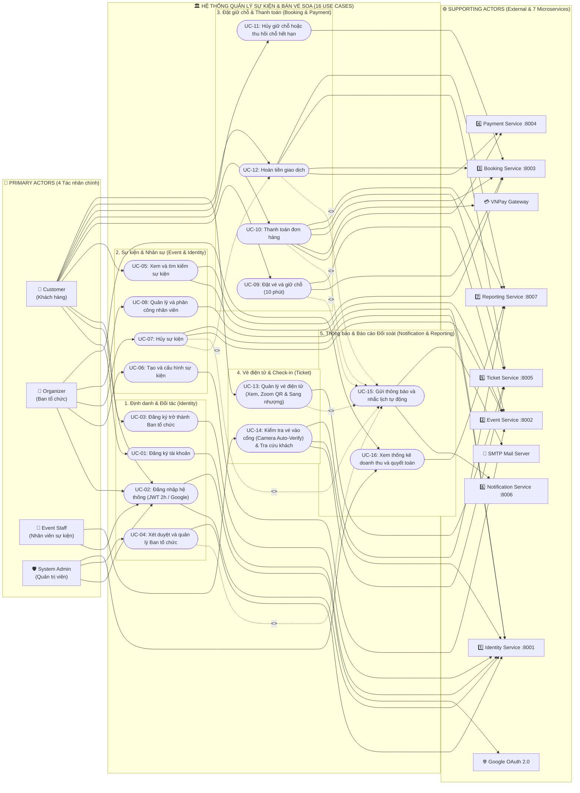
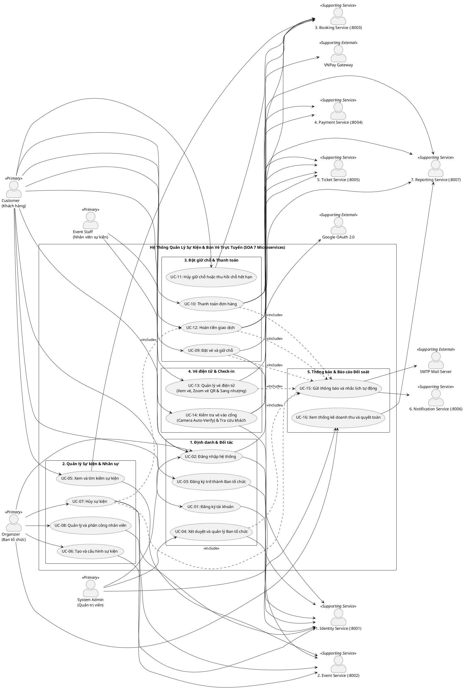

# Thiết Kế Use Case Diagram — Nền Tảng Quản Lý Sự Kiện & Bán Vé (16 Use Cases Cốt Lõi — 7 Microservices SOA)

Tài liệu thiết kế Use Case dưới đây đồng bộ hoàn toàn với **Bảng Đặc Tả 16 Use Cases ([USECASE_SPECIFICATIONS.md](file:///c:/Code/Python-Files/Microservices/soa-event-platform/USECASE_SPECIFICATIONS.md))**, bao phủ trọn vẹn **7 Microservices** và phân loại tác nhân theo chuẩn **Craig Larman (*Applying UML and Patterns*)**: **4 Primary Actors**, **10 Supporting Actors** (3 Hệ thống ngoài + 7 Microservices nội bộ) và **4 Offstage Actors**.

---

## 1. Phân Loại Đầy Đủ Các Tác Nhân (Actors Classification)

### A. Primary Actors (4 Tác nhân chính — Con người chủ động kích hoạt Use Case)
| Ký hiệu | Tác nhân (Actor) | Vai trò & Mục tiêu chính | Các Use Case thực hiện |
| :--- | :--- | :--- | :--- |
| **PA1** | **Khách hàng (Customer)** | Đăng ký tài khoản, đăng nhập (JWT 2h / Google), xem & lọc sự kiện công khai, chọn ghế/vé đứng & giữ chỗ 10 phút, thanh toán VNPay, hủy giữ chỗ, yêu cầu hoàn tiền, mở tab **"Vé của tôi"** để xem/phóng to (**Zoom**) vé điện tử QR hoặc sang nhượng vé, nộp hồ sơ nâng cấp lên Ban tổ chức. | `UC-01`, `UC-02`, `UC-03`, `UC-05`, `UC-09`, `UC-10`, `UC-11`, `UC-12`, `UC-13` |
| **PA2** | **Ban tổ chức (Organizer)** | Tạo & cấu hình sự kiện (sơ đồ ghế `Grid Map`, loại vé, giờ bán, giá Early Bird, công bố), hủy sự kiện xác thực 3 lớp, quản lý danh sách nhân viên độc lập (`#1, #2...`, tách biệt tuyệt đối email giữa các tổ chức) & phân công sự kiện, xem thống kê doanh thu/check-in và quyết toán. | `UC-02`, `UC-06`, `UC-07`, `UC-08`, `UC-16` |
| **PA3** | **Nhân viên sự kiện (Event Staff)** | Mở cửa sổ **Camera quét mã QR trực tiếp** (hoặc chọn ảnh QR / dán mã) để **tự động xác thực & check-in tức thời** mà không cần bấm nút xác thực thủ công, tra cứu danh sách khách tham dự theo quyền (`CHECKIN`, `VIEW_ATTENDEES`). | `UC-02`, `UC-14` |
| **PA4** | **Quản trị viên (System Admin)** | Xem & lọc danh sách tất cả Ban tổ chức, kiểm tra giấy phép pháp lý, thực hiện `Phê duyệt` / `Từ chối` / `Thu hồi quyền`, xem thống kê toàn sàn và phê duyệt chi trả quyết toán (`Settlement Report`). | `UC-02`, `UC-04`, `UC-16` |

*(Lưu ý: Bộ định thời `Task Scheduler` đã được chuyển xuống tầng hạ tầng `Cross-Cutting Services`, tự động kích hoạt ngầm cho `UC-11` và `UC-15` thay vì đóng vai trò Primary Actor).*

---

### B. Supporting Actors (Tác nhân phụ trợ — Cung cấp dịch vụ phía sau cho Use Case)

#### Nhóm B1 — Hệ thống tích hợp bên ngoài (External Supporting Actors)
1. **VNPay Payment Gateway**: Cổng thanh toán xử lý giao dịch ngân hàng, trả kết quả và tự động chuyển hướng (`302 Redirect`) khách hàng về trang web.
2. **Google OAuth 2.0 Server**: Xác thực danh tính người dùng khi đăng nhập một chạm bằng Google (`id_token`).
3. **SMTP / Email Server**: Hạ tầng máy chủ chuyển phát email tự động tới hộp thư người dùng.

#### Nhóm B2 — 7 Microservices nội bộ của Nền tảng (Internal Service Supporting Actors)
4. **1. Identity Service (`:8001`)**: Quản lý tài khoản, cấp & làm mới JWT Token (giới hạn phiên tối đa 2 tiếng), kiểm soát phân quyền RBAC, duyệt hồ sơ Ban tổ chức, quản lý danh sách nhân sự riêng từng tổ chức.
5. **2. Event Service (`:8002`)**: Quản lý vòng đời sự kiện, sơ đồ ghế (`Grid Map`), kiểm tra điều kiện mua vé (khung giờ mở bán, email sinh viên `@tdtu.edu.vn`, giới hạn vé/đơn, giá động Early Bird).
6. **3. Booking Service (`:8003`)**: Khóa ghế nguyên tử chống bán lố, quản lý giữ chỗ 10 phút (`TTL`) và tồn kho vé đứng, tự động thu hồi chỗ quá hạn.
7. **4. Payment Service (`:8004`)**: Tạo phiên thanh toán VNPay, chống trừ tiền 2 lần (`Idempotency Key`) và xử lý hoàn tiền (`Refund`).
8. **5. Ticket Service (`:8005`)**: Phát hành vé điện tử (`x-internal-key`), sinh ảnh mã QR chuẩn `ISO/IEC 18004` ký số `HMAC-SHA256`, đổi mã QR mới khi sang nhượng (`qr_version + 1`), tự động xác thực check-in qua camera chống quay vòng vé.
9. **6. Notification Service (`:8006`)**: Quản lý mẫu thông báo HTML, tự động gửi email khi đặt vé, thanh toán, gửi vé QR, báo hủy sự kiện và nhắc lịch trước 24h kèm cơ chế tự thử lại (`Retry`).
10. **7. Reporting Service (`:8007`)**: Tổng hợp thống kê doanh thu, tốc độ bán theo ngày, số lượng check-in theo thời gian thực và lập báo cáo đối soát quyết toán sau sự kiện (`Tổng thu - 5% phí sàn`).

---

### C. Offstage Actors (Tác nhân hậu trường — Có quyền lợi/ràng buộc được hệ thống bảo vệ)
| Ký hiệu | Tác nhân hậu trường | Mối quan tâm / Quyền lợi cần hệ thống bảo vệ (Interests) |
| :--- | :--- | :--- |
| **OA1** | **Cơ quan Thuế & Pháp lý Nhà nước** | Đảm bảo Ban tổ chức hoạt động có Mã số thuế (`tax_code`) và Giấy phép kinh doanh hợp lệ; số liệu doanh thu & hoàn tiền minh bạch. |
| **OA2** | **Trường Đại học (TDTU)** | Đảm bảo ưu đãi giá **Vé Sinh Viên** chỉ áp dụng đúng cho sinh viên có email học vụ hợp lệ (`@tdtu.edu.vn`) và đúng hạn mức. |
| **OA3** | **Ngân hàng phát hành thẻ** | Đảm bảo giao dịch thanh toán và hoàn tiền chính xác, không bị trừ tiền trùng lặp. |
| **OA4** | **Bộ phận Kế toán / Tài chính Sàn** | Kiểm soát chính xác bảng quyết toán (`settlement_reports`), khoản khấu trừ **phí nền tảng 5%**, nhật ký hoàn tiền và nhật ký check-in. |

---

## 2. Sơ Đồ Use Case Tổng Quan 16 Use Cases & 7 Microservices (Mermaid Diagram)

---

## 3. Mã PlantUML Chuẩn UML (16 Use Cases & 4 Primary Actors)

