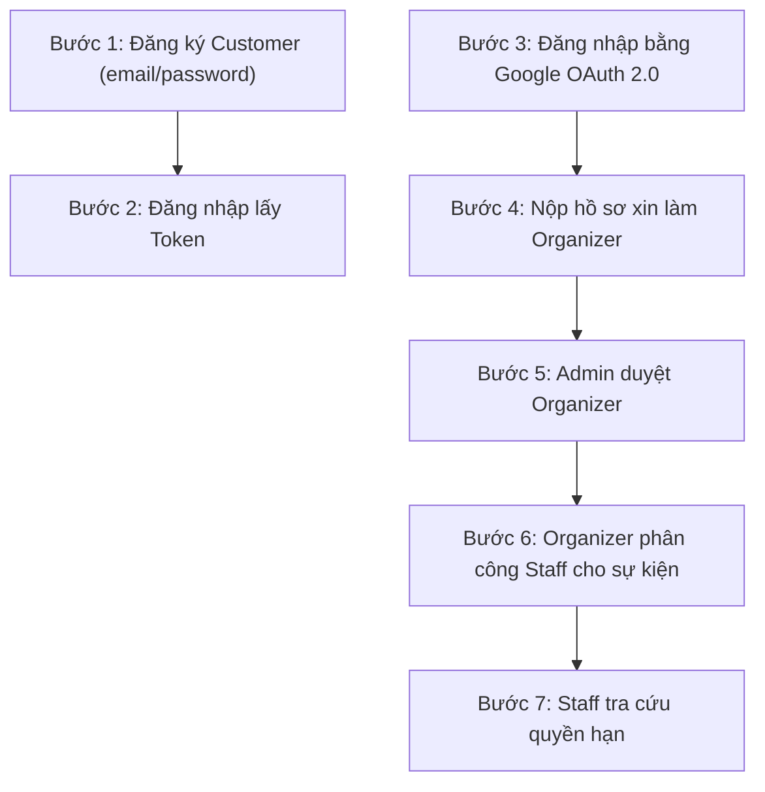

# KỊCH BẢN KIỂM THỬ (TEST SCENARIO) & DỮ LIỆU TEST
## DỊCH VỤ 1: IDENTITY SERVICE (FastAPI)

---

## 1. THÔNG TIN MÔI TRƯỜNG & KHỞI CHẠY

### 1.1. Cài đặt thư viện:
```bash
cd "C:\Users\NGOC ANH\.gemini\antigravity\scratch\soa-event-platform\services\identity_service"
pip install -r requirements.txt
```

### 1.2. Khởi chạy ứng dụng FastAPI:
```bash
uvicorn main:app --host 0.0.0.0 --port 8001 --reload
```
* **Swagger UI Documentation:** [http://localhost:8001/docs](http://localhost:8001/docs)
* **ReDoc Documentation:** [http://localhost:8001/redoc](http://localhost:8001/redoc)

---

## 2. TÀI KHOẢN MẶC ĐỊNH SẴN CÓ
Khi ứng dụng khởi động lần đầu, hệ thống tự động sinh 1 tài khoản Quản trị viên (`ADMIN`):
* **Email:** `admin@platform.com`
* **Mật khẩu:** `Admin@2027`

---

## 3. KỊCH BẢN TEST CHI TIẾT (STEP-BY-STEP)



---

### BƯỚC 1: ĐĂNG KÝ KHÁCH HÀNG MỚI (CUSTOMER)
* **Mục tiêu:** Tạo tài khoản khách hàng thông thường.
* **API:** `POST /api/v1/auth/register`
* **cURL Command:**
```bash
curl -X POST "http://localhost:8001/api/v1/auth/register" \
     -H "Content-Type: application/json" \
     -d '{
       "email": "customer01@example.com",
       "password": "Password123@",
       "full_name": "Nguyễn Văn Khách",
       "phone": "0901234567"
     }'
```
* **Kết quả mong đợi:** HTTP Status `201 Created`
```json
{
  "id": 2,
  "email": "customer01@example.com",
  "full_name": "Nguyễn Văn Khách",
  "phone": "0901234567",
  "role": "CUSTOMER",
  "status": "ACTIVE",
  "auth_provider": "LOCAL",
  "avatar_url": null,
  "created_at": "2026-11-05T09:50:00"
}
```

---

### BƯỚC 2: ĐĂNG NHẬP VỚI EMAIL & PASSWORD
* **Mục tiêu:** Xác thực và nhận JWT Token.
* **API:** `POST /api/v1/auth/login`
* **cURL Command:**
```bash
curl -X POST "http://localhost:8001/api/v1/auth/login" \
     -H "Content-Type: application/json" \
     -d '{
       "email": "customer01@example.com",
       "password": "Password123@"
     }'
```
* **Kết quả mong đợi:** HTTP Status `200 OK`
```json
{
  "access_token": "eyJhbGciOiJIUzI1NiIsInR5cCI6IkpXVCJ9...",
  "token_type": "bearer",
  "user": {
    "id": 2,
    "email": "customer01@example.com",
    "full_name": "Nguyễn Văn Khách",
    "role": "CUSTOMER"
  }
}
```
*(Hãy lưu lại chuỗi `access_token` để gắn vào header `Authorization: Bearer <token>` cho các bước sau).*

---

### BƯỚC 3: ĐĂNG NHẬP QUA GOOGLE OAUTH 2.0
* **Mục tiêu:** Đăng nhập một chạm bằng Google. Tự động tạo tài khoản nếu email chưa có trên hệ thống.
* **API:** `POST /api/v1/auth/google`

#### Dữ liệu test Mock Google Token (Dành cho việc test nhanh mà chưa cần setup Google Console):
Hệ thống đã tích hợp sẵn cơ chế Mock Token với cú pháp: `mock_google_<email>_<tên>`
* **cURL Command:**
```bash
curl -X POST "http://localhost:8001/api/v1/auth/google" \
     -H "Content-Type: application/json" \
     -d '{
       "id_token": "mock_google_lehoang@gmail.com_Lê_Văn_Hoàng"
     }'
```
* **Kết quả mong đợi:** HTTP Status `200 OK`
```json
{
  "access_token": "eyJhbGciOiJIUzI1NiIsInR5cCI6IkpXVCJ9...",
  "token_type": "bearer",
  "user": {
    "id": 3,
    "email": "lehoang@gmail.com",
    "full_name": "Lê Văn Hoàng",
    "role": "CUSTOMER",
    "status": "ACTIVE",
    "auth_provider": "GOOGLE",
    "avatar_url": "https://lh3.googleusercontent.com/mock-avatar.png"
  }
}
```
> **Lưu ý khi tích hợp với Google thật:**
> Client frontend (React / Flutter) sẽ gọi Google SDK để lấy `id_token` thật của Google (chuỗi JWT dài) và gửi lên endpoint này. Backend sẽ tự động gọi sang `https://oauth2.googleapis.com/tokeninfo` để kiểm tra.

---

### BƯỚC 4: NỘP HỒ SƠ LÊN BAN TỔ CHỨC (ORGANIZER)
* **Mục tiêu:** Tài khoản khách hàng nộp hồ sơ xin làm Ban tổ chức.
* **API:** `POST /api/v1/organizers/apply`
* **cURL Command:**
```bash
curl -X POST "http://localhost:8001/api/v1/organizers/apply" \
     -H "Content-Type: application/json" \
     -H "Authorization: Bearer <TOKEN_CỦA_CUSTOMER01>" \
     -d '{
       "organization_name": "Công ty TNHH Giải Trí & Sự Kiện TDTU",
       "tax_code": "0318899889",
       "contact_phone": "0918889999",
       "business_license_url": "https://storage.tdtu.edu.vn/licenses/giay_phep_kinh_doanh.pdf"
     }'
```
* **Kết quả mong đợi:** HTTP Status `200 OK`
```json
{
  "user_id": 2,
  "organization_name": "Công ty TNHH Giải Trí & Sự Kiện TDTU",
  "tax_code": "0318899889",
  "contact_phone": "0918889999",
  "business_license_url": "https://storage.tdtu.edu.vn/licenses/giay_phep_kinh_doanh.pdf",
  "approval_status": "PENDING",
  "approved_by_admin_id": null,
  "approved_at": null,
  "created_at": "2026-11-05T09:55:00"
}
```

---

### BƯỚC 5: ADMIN DUYỆT HỒ SƠ BAN TỔ CHỨC
1. **Đăng nhập bằng tài khoản Admin:**
```bash
curl -X POST "http://localhost:8001/api/v1/auth/login" \
     -H "Content-Type: application/json" \
     -d '{
       "email": "admin@platform.com",
       "password": "Admin@2027"
     }'
```
*(Lấy `ADMIN_TOKEN` trả về).*

2. **Admin xem danh sách hồ sơ đang chờ duyệt:**
```bash
curl -X GET "http://localhost:8001/api/v1/admin/organizers/pending" \
     -H "Authorization: Bearer <ADMIN_TOKEN>"
```

3. **Admin phê duyệt hồ sơ cho user_id = 2:**
* **API:** `PATCH /api/v1/admin/organizers/2/approve`
* **cURL Command:**
```bash
curl -X PATCH "http://localhost:8001/api/v1/admin/organizers/2/approve" \
     -H "Content-Type: application/json" \
     -H "Authorization: Bearer <ADMIN_TOKEN>" \
     -d '{
       "status": "APPROVED"
     }'
```
* **Kết quả mong đợi:** Hồ sơ chuyển sang `APPROVED`, và vai trò `role` của user 2 được tự động nâng lên thành `ORGANIZER`.

---

### BƯỚC 6: ORGANIZER PHÂN CÔNG NHÂN VIÊN (STAFF) VÀO SỰ KIỆN
* **Mục tiêu:** Ban tổ chức gán 1 nhân viên vào sự kiện số 1 (`event_id = 1`) và chỉ định các quyền hạn.
* **Chuẩn bị:** Tạo 1 tài khoản nhân viên trước:
```bash
curl -X POST "http://localhost:8001/api/v1/auth/register" \
     -H "Content-Type: application/json" \
     -d '{
       "email": "staff_checkin@tdtu.edu.vn",
       "password": "Password123@",
       "full_name": "Trần Nhân Viên Soát Vé",
       "phone": "0987654321"
     }'
```

* **Thực hiện phân công nhân viên:**
* **API:** `POST /api/v1/staff/assign`
* **cURL Command:** (Dùng Token của Organizer sau khi đăng nhập lại)
```bash
curl -X POST "http://localhost:8001/api/v1/staff/assign" \
     -H "Content-Type: application/json" \
     -H "Authorization: Bearer <ORGANIZER_TOKEN>" \
     -d '{
       "event_id": 1,
       "staff_email": "staff_checkin@tdtu.edu.vn",
       "permissions": ["CHECKIN", "VIEW_ATTENDEES"]
     }'
```
* **Kết quả mong đợi:** HTTP Status `200 OK`
```json
{
  "id": 1,
  "event_id": 1,
  "staff_user_id": 4,
  "staff_name": "Trần Nhân Viên Soát Vé",
  "staff_email": "staff_checkin@tdtu.edu.vn",
  "permissions": [
    "CHECKIN",
    "VIEW_ATTENDEES"
  ],
  "is_active": true,
  "created_at": "2026-11-05T10:00:00"
}
```

---

### BƯỚC 7: NHÂN VIÊN XEM DANH SÁCH SỰ KIỆN ĐƯỢC PHÂN CÔNG
* **Mục tiêu:** Nhân viên đăng nhập vào kiểm tra xem mình đang được phân công trực những sự kiện nào và có quyền gì.
* **API:** `GET /api/v1/staff/my-assignments`
* **cURL Command:**
```bash
curl -X GET "http://localhost:8001/api/v1/staff/my-assignments" \
     -H "Authorization: Bearer <STAFF_TOKEN>"
```
* **Kết quả mong đợi:** Trả về danh sách sự kiện và các quyền hạn được phép thực thi (VD: chỉ được quét QR soát vé).
